    

Show Image Show Image

👨‍💻 About me
🎓 Student developer, based in Morocco 🇲🇦
🧠 Currently deep into problem solving (strings, arrays, pointers, algorithms)
🌐 Building web projects with HTML, Tailwind CSS & JavaScript
🌱 Learning something new every day

 <picture> <source media="(prefers-color-scheme: dark)" srcset="https://raw.githubusercontent.com/Saidraya/Saidraya/output/github-snake-dark.svg" /> <source media="(prefers-color-scheme: light)" srcset="https://raw.githubusercontent.com/Saidraya/Saidraya/output/github-snake.svg" />  </picture> 

🛠️ Tech Stack

Show Image Show Image Show Image Show Image Show Image Show Image Show Image Show Image Show Image Show Image

📂 Featured Projects
Project	Description	Stack
🧩 problem-solving-c	120+ C exercises: strings, pointers, number bases, algorithms	Show Image
🧩 problem-solving-cpp	C++ exercises: vectors, structs, dates, algorithms	Show Image
🧩 problem-solving-js	JavaScript challenges and exercises	Show Image
🧩 problem-solving-python	Python exercises and algorithms	Show Image
⚽ Tachkila	Football squad manager: add, edit, filter players, captain, lineup	Show Image Show Image Show Image
🏦 bankproject_ATM	ATM / bank simulation project	Show Image
📊 GitHub Stats

      

🎯 My Path

📚 Learn   →   💼 Work   →   🚀 Build my own startup

📚 Now: getting the most out of my studies, problem solving and web development
💼 Next: joining a company, learning from real teams and real products
🚀 Then: leaving to build my own startup
✅ Progress
[ ] Master the fundamentals (data structures & algorithms)
[ ] Land a job at a great company and grow as an engineer
[ ] Learn how products are built, shipped and scaled
[ ] Build and launch my own startup 🚀
📫 Let's connect

GitHub Email

 

"Every expert was once a beginner."

 

